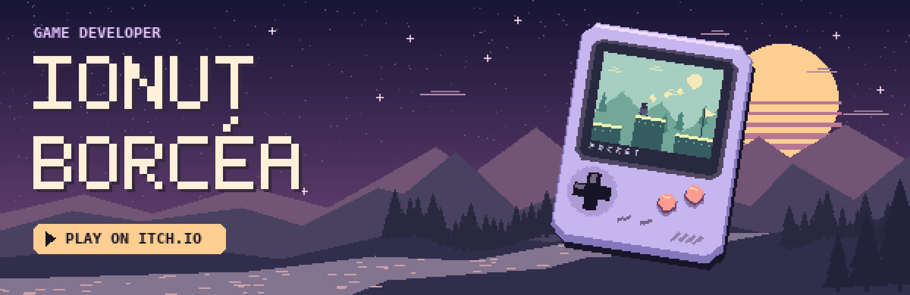

# Salut! I’m Ionuț 👋

I'm a Computer Science & Engineering student at **UDJG** (2nd year), focused on **Software Engineering** and **Game Development**. I started out exploring accounting, but I found my real passion in technology and software logic, and I've been building ever since.

**[🎮 Pick a game on itch.io ↗](https://borcea-ionut.itch.io/)** · If you’d like to explore the code, start with the pinned repositories below.

## 🛠️ My toolkit

  
  
  
  
  
  

One question I keep coming back to is **how do you change one game mechanic without breaking three others?** That’s what draws me to game architecture and design patterns. I’m also digging into data structures and algorithms.

## 💬 Say hello

If you play one of my games, tell me which moment made you want to try again. I’d also love to hear about collaborations and internship opportunities in game development or software engineering.

  
    
  
  

