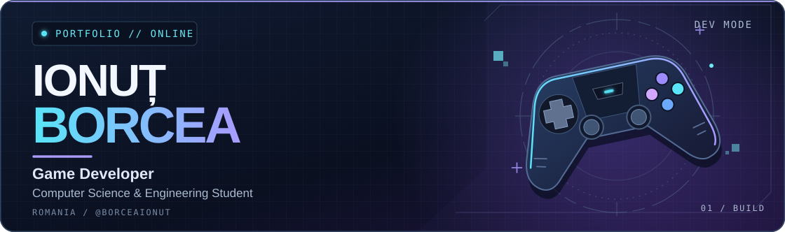
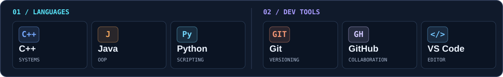
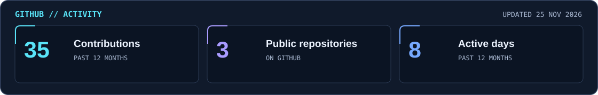
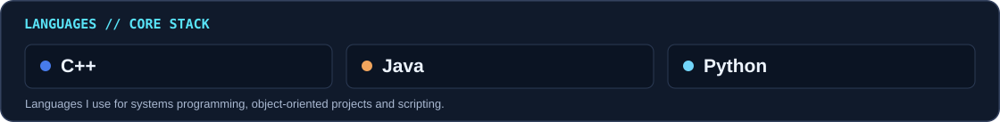
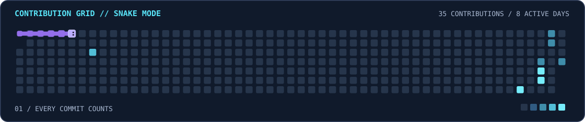
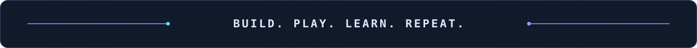

  
   
  
   
  
  
  
  

 

## About me

Hey, I'm **Ionuț Borcea** — a Computer Science & Engineering student at **UDJG**, Romania, passionate about game development and software engineering.

I enjoy turning ideas into playable experiences, solving problems through code, and learning how to build software that's as clean under the hood as it is on the screen.

- 🎮 **Building:** games and personal software projects
- 📚 **Learning:** game architecture, design patterns, data structures and algorithms
- 🤝 **Open to:** internships, collaborations and feedback

## My toolkit

  

## Selected projects

| Project | What it's about | Explore |
| :--- | :--- | :--- |
| 🎮 **Game portfolio** | Games I design, develop and publish on itch.io | [Play →](https://borcea-ionut.itch.io/) |
| 💻 **Proiecte** | A collection of academic and personal projects in C++, Java and Python | [View code →](https://github.com/borceaionut/Proiecte) |
| ☕ **Java team project** | Collaborative Java development, object-oriented programming and software design | [View code →](https://github.com/borceaionut/proiect-java-echipa) |

## GitHub activity

  
  

### Contribution snake

  

Updated automatically from GitHub. Language shares are measured by code size in my public non-fork projects, excluding this profile repository.

## Let's connect

I'm always interested in meeting fellow developers and creating interesting things together.

**[Play my games](https://borcea-ionut.itch.io/)** · **[Connect on LinkedIn](https://www.linkedin.com/in/borcea-ionut-53bb82233/)** · **[Get in touch](mailto:i.borcea33@gmail.com)**

  

